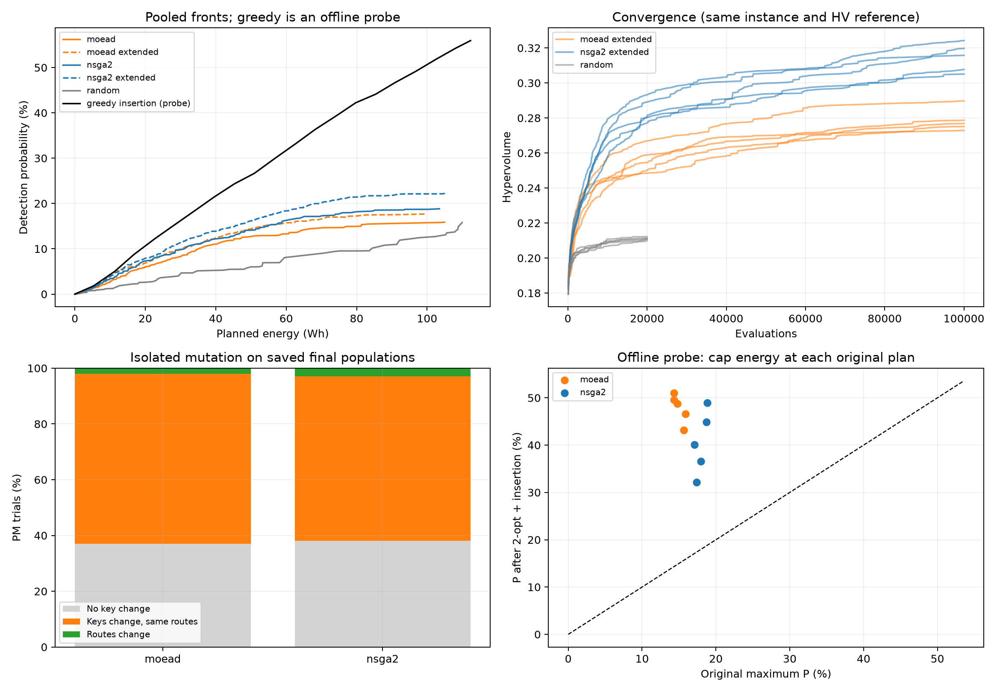

# Chẩn đoán baseline trên scenario hiện tại

Thực hiện ngày 06/11/2026. Mục tiêu: tìm điểm nghẽn có bằng chứng để thiết kế cải tiến thuật toán. Phạm vi là **SAREnv scenario 1, 256 ô, 3 UAV**, miền nhiệm vụ chuẩn hóa 100%, detector POP 3 epoch, deadline 600 s và pin 30/38/46 Wh.

**Kết quả chính:** có dư địa lớn ở tổ chức hành trình và biến đổi phenotype. Tăng ngân sách giúp cải thiện, nhưng các phép thử khai thác hình học và chèn ô cho thấy khoảng cách chất lượng lớn hơn nhiều. Đây là cơ sở chọn thí nghiệm tiếp theo; chưa phải tuyên bố về tính mới của thuật toán.



## 1. Đã thực hiện những gì

| Phép kiểm tra | Quy mô | Câu hỏi |
| --- | --- | --- |
| Đọc lại baseline 20.000 đánh giá | 2 thuật toán × 5 seed; 1.418 nghiệm archive | Hiệu quả, đa dạng và sử dụng tài nguyên ra sao? |
| Tăng ngân sách lên 100.000 | 2 thuật toán × 5 seed; 1.000.000 đánh giá | Chạy lâu hơn có giải quyết được vấn đề? |
| Random search | 5 seed × 20.000 đánh giá | EA đem lại lợi ích gì so với lấy mẫu độc lập? |
| Đột biến PM độc lập | 100 cá thể cuối × 4 lần × 5 seed cho mỗi thuật toán | Đổi gene có thực sự đổi kế hoạch? |
| 2-opt ngoại tuyến | Toàn bộ 1.418 nghiệm archive | Thứ tự bay còn lãng phí bao nhiêu? |
| 2-opt rồi chèn thêm ô | Nghiệm P lớn nhất của từng thuật toán/seed | Phần tài nguyên tiết kiệm giúp tăng P bao nhiêu? |
| Greedy insertion từ nghiệm rỗng | 21 mức trần năng lượng từ 0 đến 114 Wh | Một heuristic có dùng hình học và xác suất đạt mức nào? |

Mọi phép thử dùng cùng instance đã đóng băng. Các lượt 100.000 đánh giá tái lập lịch sử HV và P của **toàn bộ 200 thế hệ đầu** ở cả 10 cặp thuật toán/seed, sai số kiểm tra ≤10^-12. Khác biệt giữa hai ngân sách đến từ thời gian tìm kiếm bổ sung.

Random search dùng đúng quần thể đầu theo seed, sau đó lấy các lô random keys độc lập với mật độ chọn ô trải đều từ 0 đến 1; cùng decoder, evaluator, archive và số đánh giá. Đây là đối chứng theo phân bố khởi tạo hiện tại, không đại diện cho mọi chiến lược ngẫu nhiên.

## 2. Ngân sách tìm kiếm và đối chứng ngẫu nhiên

Trung bình ± độ lệch chuẩn mẫu qua 5 seed. P là **P lớn nhất của mỗi archive**, không phải P của mọi nghiệm trên front.

| Phương pháp | Đánh giá/seed | P lớn nhất (%) | HV |
| --- | ---: | ---: | ---: |
| Random search | 20.000 | 15,1453 ± 0,3685 | 0,211064 ± 0,000806 |
| NSGA-II | 20.000 | 17,9952 ± 0,7670 | 0,284047 ± 0,006822 |
| NSGA-II | 100.000 | 21,6494 ± 0,5939 | 0,314493 ± 0,008041 |
| MOEA/D | 20.000 | 14,9943 ± 0,7271 | 0,255765 ± 0,007416 |
| MOEA/D | 100.000 | 16,9110 ± 0,6803 | 0,278648 ± 0,006550 |

**Insight:** baseline chưa hội tụ hoàn toàn ở 20.000 đánh giá. Tăng ngân sách gấp 5 tăng P trung bình khoảng **3,65 điểm phần trăm** cho NSGA-II và **1,92 điểm phần trăm** cho MOEA/D.

Random search có P lớn nhất trung bình nhỉnh hơn MOEA/D ở 20.000 đánh giá, nhưng HV thấp hơn rõ. Vì thế **không đánh giá thuật toán chỉ bằng Pmax**: phải xem cả front, HV và P đạt được dưới cùng trần năng lượng. `attainment.csv` bổ sung phép đối chiếu tại 20%, 40%, 60%, 80%, 100% tổng ngân sách pin, không nội suy giữa các nghiệm.

HV dùng cùng chuẩn hóa và điểm tham chiếu (1,1; 1,1). Không so các giá trị IGD+ cũ giữa hai thư mục chạy: chúng được tính trên hai tập tham chiếu gộp khác nhau. Khi cần IGD+ cho thí nghiệm tiếp theo, phải đóng băng một tập tham chiếu chung.

## 3. Thứ tự bay là điểm nghẽn lớn

2-opt đảo một đoạn của hành trình khi làm giảm quãng đường, lặp đến khi không còn phép đảo cải thiện. Phép thử giữ nguyên tập ô và UAV phụ trách từng ô, vì thế **P giữ nguyên**, còn năng lượng/thời gian giảm.

Thống kê dưới đây lấy nghiệm P lớn nhất của mỗi seed:

| Thuật toán | Năng lượng tiết kiệm nhờ 2-opt | P trước thử nghiệm | P sau 2-opt + chèn ô |
| --- | ---: | ---: | ---: |
| NSGA-II | 29,08% ± 6,18 điểm phần trăm | 17,9952% | 40,5210% ± 6,6075 điểm phần trăm |
| MOEA/D | 36,19% ± 3,19 điểm phần trăm | 14,9943% | 47,8280% ± 3,0792 điểm phần trăm |

Bước chèn ô chọn cặp ô/UAV có tỷ lệ tăng xác suất trên Wh tăng thêm cao nhất trong các lựa chọn khả thi; xét mọi vị trí chèn. Trần năng lượng toàn đội bằng **năng lượng của chính kế hoạch gốc**, đồng thời vẫn kiểm tra pin và deadline riêng từng UAV. Các ô đã quan sát giữ nguyên UAV phụ trách.

**Ví dụ đúng MOEA/D seed 1, solution 0** mà dự án đã dùng để giải thích hành trình:

| Giai đoạn | Số ô | P | Năng lượng toàn đội |
| --- | ---: | ---: | ---: |
| Baseline gốc | 44 | 15,8890% | 104,9999 Wh |
| Chỉ đổi thứ tự bằng 2-opt | 44 | 15,8890% | 67,5881 Wh |
| Chèn thêm ô sau 2-opt | 128 | 46,5922% | 104,7291 Wh |

Ở kế hoạch cuối, thời gian về căn cứ là 558,45 / 564,68 / 536,43 s; năng lượng từng UAV là 29,03 / 35,76 / 39,94 Wh. Tất cả thỏa 600 s và pin 30/38/46 Wh.

**Diễn giải:** cùng mức tài nguyên, một hành trình gọn hơn cho phép quan sát thêm nhiều ô. Cần thử tìm kiếm cục bộ, chèn ô và toán tử giữ cấu trúc đường bay. Mức tăng này chưa chứng minh việc gắn 2-opt vào EA sẽ tạo ra cùng mức tăng trong quá trình tiến hóa: đó là thí nghiệm cần thực hiện riêng.

Hai nhóm có mức năng lượng gốc khác nhau, nên không dùng P sau chèn ô để kết luận “MOEA/D cải tiến thắng NSGA-II cải tiến”. Đây là đối chiếu trước/sau theo từng kế hoạch.

## 4. Đột biến thay đổi gene nhưng hiếm khi đổi kế hoạch

Thử đúng PM hiện tại: xác suất theo cá thể 1, theo gene 1/768, eta=20; áp dụng độc lập lên quần thể cuối đã lưu. Mỗi thuật toán có 2.000 phép thử, seed probe cố định. Không áp dụng SBX trong phép thử này.

| Chỉ số, mẫu số là toàn bộ phép thử PM | NSGA-II | MOEA/D |
| --- | ---: | ---: |
| Có ít nhất một gene đổi | 61,85% | 63,05% |
| Hành trình sau decoder đổi | **3,00%** | **1,95%** |
| Mục tiêu đổi quá sai số 10^-12 | 3,00% | 1,95% |
| Nghiệm con trội nghiệm cha | 0,25% | 0,05% |

Trung bình chỉ khoảng một gene đổi trong mỗi phép thử. Khóa chọn ô phải vượt 0,5 mới đổi quyết định; khóa phân công phải vượt biên UAV; khóa thứ tự phải ảnh hưởng thứ tự các ô thực sự được dùng. Vì vậy nhiều biến đổi số thực không tạo ra biến đổi hành trình.

**Insight:** nên thử mutation theo quyết định: thêm/bỏ ô, chuyển ô sang UAV khác, đổi vị trí ô, đảo đoạn. Đánh giá tỷ lệ đổi phenotype và xác suất tạo cải thiện, không chỉ tỷ lệ gene bị sửa. Số liệu trên mô tả PM ở quần thể cuối; không được diễn giải thành “97% offspring trong toàn bộ EA vô dụng”, vì chưa đo SBX và các thế hệ trung gian.

## 5. Chọn vùng bao phủ, detector và đa dạng

Ở các nghiệm Pmax, tổng xác suất của những ô được quan sát trung bình là **23,20% cho NSGA-II** và **19,41% cho MOEA/D**. Recall có trọng số trên các ô đó khoảng 77,57% và 77,26%.

Nếu giữ nguyên các ô và giả sử mỗi ô đều được giao cho UAV có q lớn nhất, bỏ qua pin/thời gian, cận trên P chỉ tăng từ 17,9952% lên 19,0036% cho NSGA-II và từ 14,9943% lên 15,8981% cho MOEA/D. Đây là cận lạc quan, chưa chắc có hành trình khả thi.

**Insight:** với cấu hình q hiện tại, mở rộng bao phủ và giảm chi phí di chuyển có dư địa lớn hơn việc chỉ chuyển các ô hiện có sang UAV có detector tốt hơn. Việc huấn luyện detector và kiểm tra khả năng chuyển miền vẫn là bài toán riêng.

Quần thể cuối còn trung bình 86,6/100 hành trình phân biệt ở NSGA-II và 79,0/100 ở MOEA/D. Archive và quần thể cuối cũng có HV khá gần nhau. Chưa có bằng chứng đủ mạnh để xem sụp đổ đa dạng là điểm nghẽn ưu tiên hơn chất lượng hành trình và hiệu lực mutation.

Khởi tạo đề xuất trung bình khoảng 128 ô/cá thể và decoder phải loại khoảng 75% số ô đề xuất. Quần thể cuối loại rất ít ô nếu lấy trung bình trên cả quần thể. Riêng các nghiệm Pmax lưu trong archive MOEA/D vẫn có thể chứa nhiều đề xuất bị loại. Cần tách rõ **tỷ lệ cá thể cần repair**, **tỷ lệ ô bị loại**, và **giai đoạn tìm kiếm** khi đánh giá decoder.

## 6. Greedy là đối chứng cần bổ sung

Greedy insertion từ nghiệm rỗng, với trần năng lượng 114 Wh, tìm được kế hoạch **152 ô, P=55,9446%, E=112,3412 Wh**. Ba UAV về căn cứ sau 572,21 / 597,04 / 595,69 s và dùng 29,8050 / 37,9027 / 44,6335 Wh.

Phép thử chọn theo tăng P/tăng Wh và xét mọi vị trí chèn; không dùng dữ liệu ngoài instance. Sweep 21 trần năng lượng thực hiện tổng cộng **15.647.146 lượt xét vị trí chèn**, HV của tập kết quả là 0,522022. Đây không phải 21 lần đánh giá tương đương 21 cá thể EA: bên trong có nhiều phép xét ứng viên.

**Insight:** hai EA hiện tại còn là baseline tổng quát khá yếu trên cấu trúc hình học này. Giai đoạn sau nên có thêm greedy có dùng xác suất, greedy + local search, rồi mới so thuật toán đề xuất. Con số 55,9446% là một nghiệm khả thi đã tìm được, không phải P tối ưu hay cận trên của bài toán.

## 7. Thứ tự thí nghiệm tiếp theo

Giữ scenario này làm tập phát triển. Mỗi lần thay một thành phần để biết thành phần nào tạo hiệu quả:

| Ưu tiên | Biến thể cần kiểm chứng | Giả thuyết |
| --- | --- | --- |
| 1 | Baseline + 2-opt có giới hạn | Tận dụng cấu trúc hành trình giảm E và mở thêm khả năng quan sát |
| 2 | Baseline + mutation theo hành trình | Tăng tỷ lệ biến đổi phenotype hữu ích so với PM |
| 3 | Khởi tạo pha trộn greedy/random | Có nghiệm tốt sớm mà vẫn giữ nhiều cách phân công và miền năng lượng |
| 4 | Chèn ô theo tăng P/tăng E; relocate/swap giữa UAV | Cải thiện đồng thời chọn ô, phân công và sử dụng tài nguyên |
| 5 | Ghép các thành phần đã có hiệu quả riêng | Kiểm tra hiệu quả kết hợp và phần đóng góp của từng thành phần |

Cho cả NSGA-II và MOEA/D hưởng cùng thành phần cải tiến trong lượt đầu để tách hiệu quả của thành phần khỏi cơ chế chọn lọc. Khi ghép thành phương pháp đề xuất, cần ablation bỏ từng thành phần; có thể dùng thiết kế 2^3 cho ba thành phần chính nếu chi phí cho phép.

Ngân sách cần ghi cả đánh giá fitness, số ứng viên local search/insertion, số phép tính khoảng cách và thời gian. Báo cáo HV theo đánh giá **và theo thời gian**; dùng thêm đối chiếu cùng giới hạn thời gian. Không cho một phương pháp local search không giới hạn rồi tuyên bố công bằng chỉ vì cùng 20.000 lượt gọi evaluator ngoài cùng.

Sau khi chọn được cấu trúc có hiệu quả: kiểm chứng trên seed mới, các miền/scenario giữ lại, quy mô khác nhau, deadline/pin chặt–vừa–rộng và độ khác biệt UAV. Nếu thay q nhân tạo để làm thí nghiệm nhạy cảm, phải ghi đó là biến thể mô hình, tách khỏi q đo trên POP.

Hướng phương pháp đáng khảo sát là **EA kết hợp tìm kiếm cục bộ trên hành trình và biến đổi có xét tăng xác suất/chi phí tài nguyên**. 2-opt, greedy và các phép relocate/swap là thành phần quen thuộc; tính mới chỉ được xác lập sau khi đối chiếu tài liệu, xác định đóng góp riêng và có thực nghiệm kiểm chứng.

## 8. Mã, dữ liệu và tái lập

- Mã: [diagnostics.py](../uav_sar/diagnostics.py), CLI `run.py diagnose`; [kiểm thử](../tests/test_diagnostics.py).
- [Instance đóng băng](../artifacts/diagnostics_mission/instance.json), [tổng hợp](../artifacts/diagnostics_mission/summary.json), [manifest](../artifacts/diagnostics_mission/manifest.json).
- [So ngân sách theo seed](../artifacts/diagnostics_mission/budget_comparison.csv), [mutation](../artifacts/diagnostics_mission/mutation_probes.csv), [quần thể](../artifacts/diagnostics_mission/population_diagnostics.csv).
- [Chẩn đoán từng lượt](../artifacts/diagnostics_mission/run_diagnostics.csv), [từng hành trình UAV](../artifacts/diagnostics_mission/route_diagnostics.csv), [P theo trần năng lượng](../artifacts/diagnostics_mission/attainment.csv).
- [Hành trình trước/sau phép thử](../artifacts/diagnostics_mission/probe_routes.json), [kết quả greedy](../artifacts/diagnostics_mission/greedy_controls.json).
- Dữ liệu chạy đầy đủ tại `results/baseline_mission_budget100k/` và `results/diagnostics_mission/`. Snapshot nhỏ để đọc trên GitHub nằm trong `artifacts/diagnostics_mission/`.

Ví dụ chạy lại từ input snapshot; dùng tên thư mục output mới:

```powershell
$py = '.venv/Scripts/python.exe'
& $py -u run.py run --instance artifacts/diagnostics_mission/instance.json --generations 200 --seeds 1 2 3 4 5 --output results/reproduce_20k
& $py -u run.py run --instance artifacts/diagnostics_mission/instance.json --generations 1000 --seeds 1 2 3 4 5 --output results/reproduce_100k
& $py -u run.py diagnose --results results/reproduce_20k --extended-results results/reproduce_100k --output results/reproduce_diagnostics
```

**Kiểm tra:** 19 kiểm thử qua. Ngoài kiểm tra trong CLI, lượt này được kiểm tra độc lập từ tọa độ bằng `math.dist`/`math.fsum`: **2.654 kế hoạch** gồm 2.272 nghiệm archive mở rộng, 331 nghiệm random và 51 kế hoạch của các phép thử. Tất cả thỏa tính duy nhất của ô, pin/deadline từng UAV; mọi trần năng lượng của phép chèn được giữ. Sai số P tối đa khoảng 1,11×10^-16; thời gian 2,28×10^-13 s; năng lượng 2,85×10^-14 Wh. [Audit bổ sung của lượt này](../artifacts/diagnostics_mission/audit.json).

Đây là chẩn đoán trên **một instance, 5 seed**. Các kết quả giúp chọn giả thuyết để kiểm chứng; chưa đủ để suy rộng ưu thế thuật toán cho toàn bộ bài toán Multi-UAV SAR.

Tham khảo cách dùng [PM](https://pymoo.org/operators/mutation.html) và [chỉ số hội tụ](https://pymoo.org/getting_started/part_4.html); hành vi thực tế trong thí nghiệm được đối chiếu mã pymoo **0.6.1.5** đang cài, không suy từ phiên bản mới của tài liệu.
