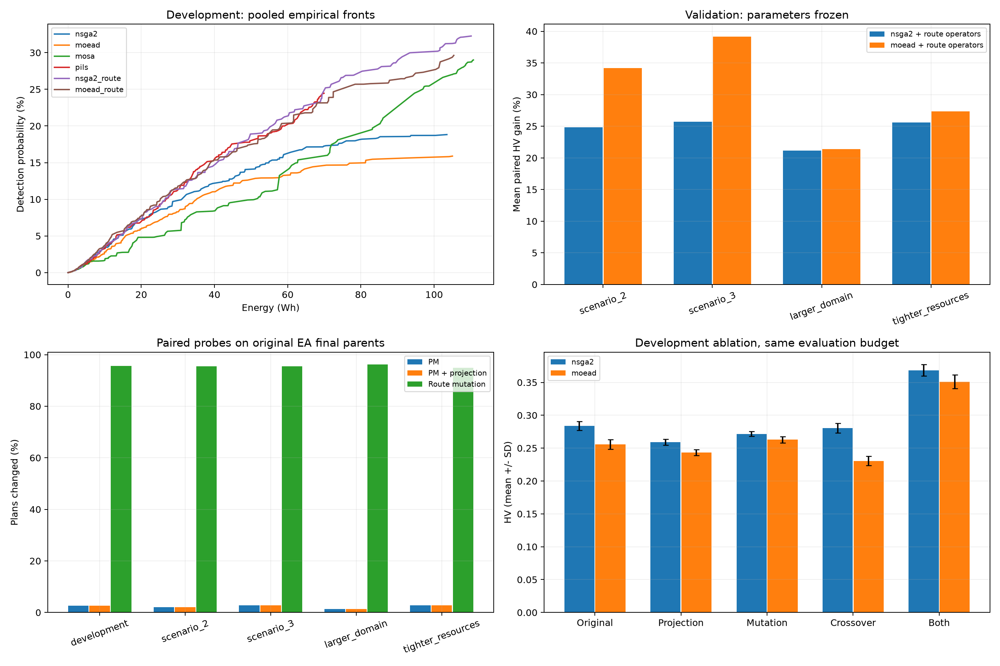
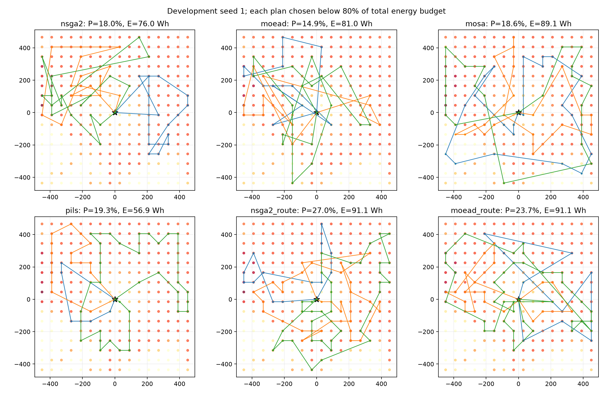

# Kết quả bốn baseline và cơ chế biến đổi hành trình

Ngày 06/11/2026. Giao thức tại [baseline-study-protocol.md](baseline-study-protocol.md); thiết kế và điều kiện tổng quát hóa tại [route-mechanism-design.md](route-mechanism-design.md).

**Đã chạy 180 lượt, 3.600.000 đánh giá**, gồm bốn baseline, ablation cho hai EA và bốn trường hợp kiểm chứng với seed mới. Điểm yếu nổi bật là sự tương tác giữa biểu diễn, mutation và crossover; tăng tần suất đổi phenotype riêng lẻ chưa đủ để cải thiện tìm kiếm.



## 1. Hai baseline mới so với hai EA

Scenario 1 hiện tại, 256 ô, 3 UAV, deadline 600 s, pin 30/38/46 Wh; mỗi phương pháp có 5 seed × 20.000 đánh giá. Trung bình ± độ lệch chuẩn mẫu. Pmax là xác suất lớn nhất của từng archive.

| Phương pháp | Pmax (%) | HV | Thời gian tìm kiếm trung bình |
| --- | ---: | ---: | ---: |
| NSGA-II | 17,995 ± 0,767 | 0,284047 ± 0,006822 | 3,86 s |
| MOEA/D | 14,994 ± 0,727 | 0,255765 ± 0,007416 | 10,08 s |
| **MOSA-TCH** | **28,322 ± 0,461** | 0,293723 ± 0,003585 | 1,66 s |
| **Pareto ILS lấy mẫu** | 20,178 ± 2,530 | **0,314645 ± 0,015340** | 1,58 s |

MOSA đạt Pmax cao hơn, còn PILS tạo tập trade-off có HV tốt hơn trong bốn baseline ở cấu hình này. Không dùng riêng Pmax để kết luận thuật toán thắng toàn bộ front. MOSA/PILS là các bản thích nghi được mô tả rõ trong giao thức, chưa phải những bản đã tuning đầy đủ.

Cả 10 lượt EA chạy lại tái lập toàn bộ 200 dòng lịch sử trước đó về số đánh giá, archive size, HV, Pmax và repair fraction, sai số kiểm tra ≤10^-12. Kết quả mới không đến từ việc thay cách tính mục tiêu hoặc làm yếu baseline gốc.

## 2. Ablation cho thấy tương tác giữa hai toán tử

Cơ chế mẫu kết hợp mutation trực tiếp trên hành trình và crossover giữ prefix. Cả hai tiếp tục dùng 3N keys, decoder và bộ chọn lọc EA gốc.

| Biến thể | HV trung bình NSGA-II | HV trung bình MOEA/D |
| --- | ---: | ---: |
| Gốc: SBX + PM | 0,284047 | 0,255765 |
| Chỉ PM rồi mã hóa lại phenotype | 0,259310 | 0,243550 |
| Chỉ thay mutation | 0,271690 | 0,262849 |
| Chỉ thay crossover | 0,280584 | 0,230640 |
| **Kết hợp hai toán tử hành trình** | **0,368417** | **0,351070** |

Chỉ làm mutation đổi phenotype nhiều hơn không bảo đảm tốt hơn. Chỉ giữ cấu trúc crossover cũng chưa đủ; với MOEA/D còn làm HV giảm rõ. Việc kết hợp hai thành phần tạo hiệu quả lớn hơn nhiều so với dùng riêng.

Đo tương tác bằng `I = HV_both - HV_mutation - HV_crossover + HV_original`, ghép cùng seed: I dương ở cả 10 cặp. Trung bình I là **0,100190 cho NSGA-II** và **0,113347 cho MOEA/D**. Đây là tương tác theo thước đo HV và các thành phần đã cài đặt, không phải một định lý về mọi bộ toán tử EA.

Với cơ chế kết hợp, Pmax trung bình là **30,958%** cho NSGA-II và **27,389%** cho MOEA/D. Chi phí tìm kiếm tăng lên khoảng **6,50 s** và **15,78 s**; vì vậy phải xét thêm đối chiếu thời gian.

## 3. Điểm yếu lặp lại qua các trường hợp

### 3.1. Mutation bị phân tán vào các quyết định không hoạt động

Probe độc lập trên quần thể cuối của EA gốc cho kết quả:

| Trường hợp | PM đổi kế hoạch, NSGA-II | PM đổi kế hoạch, MOEA/D | Mutation hành trình, NSGA-II / MOEA/D |
| --- | ---: | ---: | ---: |
| Phát triển | 3,00% | 2,25% | 96,30% / 94,95% |
| Scenario 2 | 2,20% | 1,95% | 96,95% / 94,05% |
| Scenario 3 | 2,90% | 2,55% | 96,30% / 94,75% |
| Miền 576 ô | 1,55% | 1,25% | 96,50% / 95,80% |
| Tài nguyên ×0,7 | 3,15% | 2,30% | 95,90% / 93,90% |

Các tỷ lệ này là phép thử trên cha đã lưu, không phải đo mọi offspring online; seed probe của study được quy định riêng. Tỷ lệ đổi phenotype cao cũng không đồng nghĩa mọi thay đổi có ích cho mục tiêu, như ablation đã cho thấy.

Để tách hiệu ứng kích thước khỏi việc đổi bản đồ/diện tích, làm thêm **probe thăm dò trên tập phát triển**: nối gene không ảnh hưởng giải mã vào cùng các cha vật lý; PM vẫn dùng xác suất `1/n_var` theo cấu hình hiện tại.

| Tổng số chiều | PM đổi kế hoạch, NSGA-II | PM đổi kế hoạch, MOEA/D |
| --- | ---: | ---: |
| D=768, gốc | 2,87% | 2,22% |
| 2D, thêm D gene không hoạt động | 1,52% | 1,13% |
| 4D, thêm 3D gene không hoạt động | 0,74% | 0,53% |

Bài toán vật lý và kế hoạch cha giữ nguyên; chỉ thay cách phân bổ xác suất mutation trên số chiều. Điều này hỗ trợ cơ chế **pha loãng ngân sách biến đổi theo tọa độ** của cấu hình hiện tại. Nó không chứng minh mọi cách đặt xác suất PM đều có vấn đề; tuning rate hoặc phân phối xác suất theo loại gene là những đối chứng cần có ở bước nghiên cứu tiếp theo.

### 3.2. Mã hóa lại có thể làm khó việc đổi tập ô

Ở probe thăm dò riêng, PM trên cha raw thay tập ô trong khoảng **1,56% / 1,61%** phép thử của NSGA-II/MOEA/D. Sau khi chiếu cùng kế hoạch cha về keys 0,25/0,75, tỷ lệ này chỉ còn **0,06% / 0,05%**.

Phép chiếu giữ nguyên kế hoạch nhưng đưa khóa chọn ra xa ngưỡng 0,5. Đây là một lý do phải xem phân bố genotype sau mỗi thành phần: cùng phenotype không có nghĩa cùng khả năng tìm kiếm ở bước kế tiếp. Đối chứng chỉ mã hóa lại đã giảm HV, nên không thể mặc định projection là cải tiến.

### 3.3. SBX kế thừa ít cấu trúc cạnh hơn

Trên cùng cặp cha, probe đo tỷ lệ cạnh của con nằm trong hợp các cạnh cha, tính sau decoder. Qua các trường hợp/EA, SBX giữ khoảng **63–72%**, còn crossover hành trình khoảng **92–94%**. Cạnh được xét vô hướng và gắn UAV; đây là thước đo kế thừa cấu trúc, không trực tiếp là thước đo fitness.

Kết hợp với ablation, bằng chứng phù hợp với giả thuyết: mutation cần tạo thay đổi quyết định thực sự, đồng thời crossover cần giữ được những cấu trúc đang làm các quyết định đó hiệu quả. Không quy toàn bộ chênh lệch giữa MOSA/PILS và EA cho riêng SBX: bốn baseline còn khác cách chấp nhận và xử lý đề xuất vi phạm.

### 3.4. Prototype vẫn còn khoảng trống hình học

2-opt ngoại tuyến trên các nghiệm Pmax của hai EA gốc còn tiết kiệm khoảng **22–36%** năng lượng, tùy trường hợp. Cơ chế kết hợp giảm bớt khoảng trống này nhưng vẫn còn khoảng **7–23%**. Với PILS, phần còn lại chỉ khoảng **0,6–1,7%**.

Do đó, giữ cấu trúc khi recombination chưa thay thế được khai thác cục bộ hiệu quả. Đây là điểm cần giải quyết tiếp, đặc biệt khi mục tiêu là cạnh tranh theo thời gian với PILS.

## 4. Kiểm chứng với tham số cố định

Bốn trường hợp mới dùng seed 11–15, giữ các tham số toán tử đã chọn. Bảng là **trung bình mức tăng HV ghép cùng instance/seed** so với EA gốc; không lấy tỷ số hai trung bình rồi trộn với thước đo ghép cặp.

| Kiểm chứng | NSGA-II + cơ chế | MOEA/D + cơ chế | Số cặp tăng HV |
| --- | ---: | ---: | ---: |
| Scenario 2 | +24,85% | +34,16% | 5/5 cho mỗi EA |
| Scenario 3 | +25,70% | +39,17% | 5/5 cho mỗi EA |
| Miền 576 ô | +21,16% | +21,41% | 5/5 cho mỗi EA |
| Tài nguyên ×0,7 | +25,57% | +27,37% | 5/5 cho mỗi EA |

Cơ chế kết hợp tăng HV ở **40/40 cặp kiểm chứng** trong các lượt đã chạy. Điều này hỗ trợ khả năng dùng lại với hai cơ chế chọn lọc và các thay đổi đã thử, không phải bảo đảm hiệu quả trên mọi instance hay mọi mô hình UAV.

Quần thể cuối của NSGA-II với cơ chế kết hợp còn trung bình 98,8/100 hành trình khác nhau trên tập phát triển, so với 86,6 của bản gốc. Ở miền rộng hơn, MOEA/D gốc chỉ còn khoảng 55,2/100 hành trình phân biệt, còn bản kết hợp khoảng 77,6. Hiện tượng đa dạng cần được theo dõi theo điều kiện; không dùng nó làm lời giải thích duy nhất.

## 5. Kết quả theo thời gian đặt ra yêu cầu tiếp theo

Trong tập phát triển, mốc thời gian chung là khoảng **1,563 s**, lấy checkpoint cuối không vượt mốc cho từng lượt:

| Phương pháp | HV trung bình tại mốc thời gian chung |
| --- | ---: |
| NSGA-II | 0,261495 |
| MOEA/D | 0,231116 |
| MOSA | 0,288260 |
| **PILS** | **0,314028** |
| NSGA-II + cơ chế | 0,295507 |
| MOEA/D + cơ chế | 0,260461 |

Cơ chế kết hợp cũng cải thiện so với **chính EA gốc** ở mốc thời gian chung trong mọi cặp đã chạy. Tuy nhiên, **PILS có HV trung bình cao nhất ở mốc thời gian chung trên cả năm trường hợp**. Với cùng 20.000 đánh giá, NSGA-II + cơ chế có HV trung bình cao nhất trong sáu phương pháp cốt lõi trên cả năm trường hợp.

Đây là hai kết luận khác nhau. Prototype chưa thể được gọi là phương pháp hiệu quả nhất về thời gian. Các mốc thời gian khoảng 1,53–1,56 s, lấy từ lịch sử cùng một phiên máy và có độ phân giải 100 đánh giá; cần lặp lại phép đo trên môi trường chuyên dụng trước khi báo cáo hiệu năng thời gian cho paper.

## 6. Hướng cơ chế tiếp theo

Điểm đáng khai thác là **tương tác giữa loại biến đổi và cấu trúc được kế thừa**, cùng chi phí tính toán. Hướng thiết kế cụ thể tại [route-mechanism-design.md](route-mechanism-design.md):

- Cơ chế mẫu hiện có: mutation theo quyết định + crossover giữ cấu trúc; đã có ablation và kiểm chứng tham số cố định.
- Thiết kế tiếp theo, chưa triển khai: điều phối **cặp crossover–mutation** bằng credit chung có xét chi phí, thay vì chọn độc lập từng toán tử.
- Cần dùng PILS làm đối chứng về khai thác cục bộ và thời gian; nếu thêm local search, giới hạn và tính rõ mọi chi phí nội bộ.
- Đối chiếu với tuning PM/SBX và adaptive operator selection độc lập, rồi kiểm chứng bằng scenario/seed mới dành riêng cho thiết kế tiếp theo.

Các thành phần routing, memetic search và bandit có tiền lệ. Thí nghiệm hiện tại cung cấp giả thuyết và prototype kiểm chứng được; chưa tự xác lập một thuật toán có tính mới học thuật.

## 7. Hành trình và dữ liệu để xem lại



Hình chọn trước quy tắc: scenario phát triển, seed 1, nghiệm có P cao nhất dưới trần **91,2 Wh** cho từng phương pháp. Trần bằng nhau không có nghĩa mọi nghiệm dùng hết cùng lượng năng lượng. Màu nền biểu thị pi, ngôi sao là căn cứ; ba màu đường bay tương ứng ba UAV. Tọa độ tính bằng mét so với căn cứ.

Snapshot đọc được trên GitHub nằm tại [artifacts/baseline_mechanism_study](../artifacts/baseline_mechanism_study):

- [Tổng hợp theo instance/phương pháp](../artifacts/baseline_mechanism_study/summary.csv), [từng lượt](../artifacts/baseline_mechanism_study/runs.csv), [hiệu ứng ghép cặp](../artifacts/baseline_mechanism_study/paired_effects.csv).
- [Probe chính](../artifacts/baseline_mechanism_study/variation_probes.csv), [probe thăm dò](../artifacts/baseline_mechanism_study/exploratory_probes.csv), [tương tác](../artifacts/baseline_mechanism_study/interaction_effects.csv), [quần thể](../artifacts/baseline_mechanism_study/population_diagnostics.csv).
- [P dưới các trần năng lượng](../artifacts/baseline_mechanism_study/attainment.csv), [30 kế hoạch minh họa](../artifacts/baseline_mechanism_study/representative_plans.json), [input đóng băng](../artifacts/baseline_mechanism_study/inputs).
- [Protocol](../artifacts/baseline_mechanism_study/protocol.json), [môi trường](../artifacts/baseline_mechanism_study/environment.json), [manifest](../artifacts/baseline_mechanism_study/manifest.json), [audit](../artifacts/baseline_mechanism_study/audit.json).

Kết quả đầy đủ tại `results/baseline_four_methods/` và `results/baseline_mechanism_study/`, gồm mọi archive, quần thể cuối, lịch sử và hành trình. Chạy lại theo giao thức; các probe thăm dò và snapshot được tạo bằng:

```powershell
& $py -u scripts/study_followup.py --study results/baseline_mechanism_study --snapshot artifacts/study_snapshot_new
```

**Kiểm tra:** 40 kiểm thử qua. Đã tính lại độc lập **24.772 nghiệm đã lưu** bằng `math.dist`/`math.fsum`, đối chiếu mục tiêu với NPZ, tính duy nhất ô và pin/deadline riêng từng UAV. Ngân sách và HV khởi tạo ghép theo seed khớp cho toàn bộ cohort. Năm seed và bốn trường hợp kiểm chứng vẫn là quy mô nghiên cứu ban đầu trong cùng mô hình 2D/q theo UAV; chưa suy rộng sang SAR thực địa.
