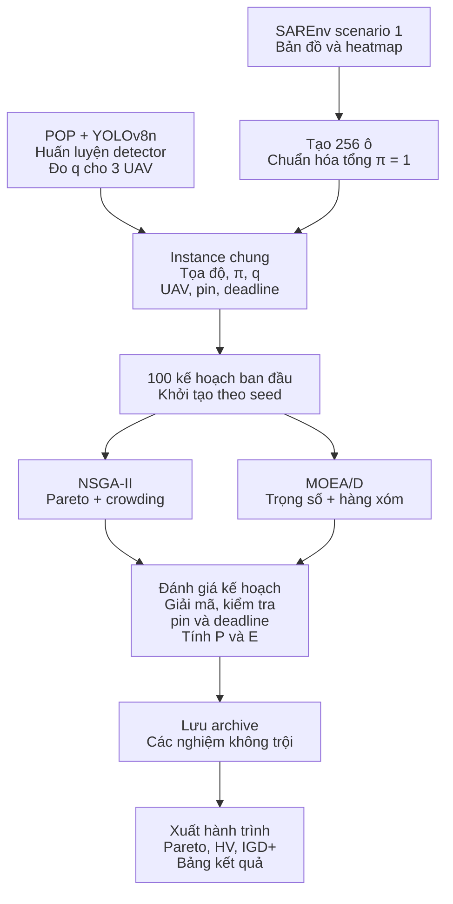

# Multi-UAV Search and Rescue: mô hình tối ưu và hai baseline EA

> Cập nhật: 05/11/2026. Phần 1–2 phát biểu bài toán độc lập với thuật toán; phần 3–8 mô tả dữ liệu và cách code giải bằng NSGA-II/MOEA/D. Miền nhiệm vụ được chuẩn hóa tổng xác suất bằng 1.

## 1. Phát biểu bài toán bằng lời

Cho một miền nhiệm vụ đã chia thành N ô, có một nạn nhân đứng yên nhưng chưa biết vị trí. Xác suất nạn nhân ở từng ô được biết trước, không nhất thiết bằng nhau và có tổng bằng 1. Đội K UAV có tốc độ, công suất, pin và hiệu quả phát hiện khác nhau; quan sát đúng ô vẫn có thể bỏ sót người.

**Cần quyết định:** chọn những ô nào, giao mỗi ô cho UAV nào và thứ tự di chuyển của từng UAV. Mỗi ô được quan sát tối đa một lần trên toàn đội. UAV tham gia phải xuất phát, quan sát rồi quay về căn cứ trong deadline và ngân sách pin.

Hai mục tiêu: **tối đa xác suất phát hiện** và **tối thiểu tổng năng lượng toàn kế hoạch**. Đầu ra là tập phương án Pareto, không phải một phương án với trọng số ưu tiên cố định.

Mô hình hiện tại lập kế hoạch offline trên mặt phẳng 2D, bay theo đoạn thẳng Euclid, quan sát cố định tau giây/ô. Các UAV xuất phát cùng thời điểm 0; được phép không tham gia. Không tính phát hiện khi chỉ bay ngang ô và không dừng sớm sau phát hiện. Chưa mô hình hóa va chạm, vùng cấm bay, liên lạc, gió hoặc hoạt động cứu hộ sau phát hiện.

## 2. Phát biểu toán học của bài toán tối ưu

### 2.1. Tập chỉ số, tham số và biến quyết định

Đặt miền nhiệm vụ là Omega, tập ô $`V=\{1,\ldots,N\}`$. Với UAV k, đặt $`V_k^+=V\cup\{b_k\}`$ và $`A_k=\{(u,v):u,v\in V_k^+,u\ne v\}`$.

| Ký hiệu | Ý nghĩa |
| --- | --- |
| $`b_k,p_j,p_{b_k}`$ | Căn cứ UAV k; tọa độ tâm ô j và căn cứ, m |
| $`\pi_j`$ | Xác suất nạn nhân ở ô j, có điều kiện nạn nhân trong Omega |
| $`q_{kj}`$ | Xác suất UAV k phát hiện đúng khi quan sát ô j có nạn nhân |
| $`d_{uv}^k=\lVert p_u-p_v\rVert_2`$ | Khoảng cách giữa hai nút, m |
| $`v_k`$ | Tốc độ bay, m/s |
| $`P_k^{fly},P_k^{obs}`$ | Công suất pha bay và tổng công suất pha quan sát, W |
| $`B_k,T,\tau`$ | Ngân sách pin Wh; deadline s; thời gian quan sát một ô s |
| $`x_{kj}\in\{0,1\}`$ | UAV k thực hiện quan sát ô j |
| $`y_{uv}^k\in\{0,1\}`$ | UAV k sử dụng cung bay (u,v) |
| $`z_k\in\{0,1\}`$ | UAV k tham gia nhiệm vụ |
| $`h_{kj}\ge0`$ | Biến thứ tự phụ trợ để loại chu trình con |

Các tham số xác suất thỏa $`\pi_j\ge0`$, $`\sum_j\pi_j=1`$, $`0\le q_{kj}\le1`$. Với trọng số heatmap nguồn w_j và xác suất miền m_Omega:

```math
m_\Omega=\sum_{j\in V}w_j,\qquad \pi_j=\frac{w_j}{m_\Omega}.
```

Đây là phân bố có điều kiện nạn nhân trong miền, giữ tỷ lệ cao–thấp của heatmap. Xác suất quy về nguồn là $`P_{source}=m_\Omega P_{detect}`$; metadata giữ `raw_crop_mass=m_Omega`.

### 2.2. Hai hàm mục tiêu

Gọi $`n_k=\sum_jx_{kj}`$ là số ô và $`D_k=\sum_{(u,v)\in A_k}d_{uv}^ky_{uv}^k`$ là tổng quãng đường gồm đường về. Khi đó:

```math
T_k=D_k/v_k+\tau n_k,\qquad
E_k=\frac{P_k^{fly}D_k/v_k+P_k^{obs}\tau n_k}{3600}.
```

Hệ số 3600 đổi J sang Wh. Công suất quan sát đã gồm duy trì bay/treo; hai pha không tính trùng.

**Tối đa xác suất phát hiện:**

```math
\max f_1(x)=P_{detect}(x)=\sum_{j\in V}\pi_j\sum_{k=1}^Kx_{kj}q_{kj}.
```

**Tối thiểu năng lượng toàn kế hoạch:**

```math
\min f_2(x,y)=E_{total}(x,y)=\sum_{k=1}^KE_k.
```

Công thức P dùng xác suất toàn phần cho vị trí của một nạn nhân và quy tắc mỗi ô tối đa một lượt, không cần giả định các ô độc lập. Với phân công x cố định, thay thứ tự không đổi P nếu vẫn hoàn thành mọi lượt trước T; thứ tự vẫn ảnh hưởng năng lượng và tính khả thi.

### 2.3. Hệ ràng buộc

```math
\begin{aligned}
&\sum_kx_{kj}\le1 &&\forall j\in V &&\text{(C1)}\\[0.25em]
&\sum_{j\in V}y_{b_kj}^k=\sum_{j\in V}y_{jb_k}^k=z_k
&&\forall k &&\text{(C2)}\\[0.25em]
&\sum_{u\in V_k^+\setminus\{j\}}y_{uj}^k
=\sum_{v\in V_k^+\setminus\{j\}}y_{jv}^k=x_{kj}
&&\forall k,j &&\text{(C3)}\\[0.25em]
&x_{kj}\le z_k &&\forall k,j &&\text{(C4)}\\[0.25em]
&x_{kj}\le h_{kj}\le Nx_{kj} &&\forall k,j &&\text{(C5a)}\\[0.25em]
&h_{kj}\ge h_{ki}+1-(N+1)(1-y_{ij}^k)
&&\forall k,\ i,j\in V,\ i\ne j &&\text{(C5b)}\\[0.25em]
&D_k/v_k+\tau n_k\le T &&\forall k &&\text{(C6)}\\[0.25em]
&\left(P_k^{fly}D_k/v_k+P_k^{obs}\tau n_k\right)/3600\le B_k
&&\forall k &&\text{(C7)}\\[0.25em]
&x_{kj},y_{uv}^k,z_k\in\{0,1\} &&\forall k,j,(u,v)\in A_k &&\text{(C8)}.
\end{aligned}
```

C1 tránh quan sát trùng; C2 buộc xuất phát/quay về; C3 liên kết phân công với cung vào/ra; C4 cho phép UAV nghỉ. C5 loại các chu trình giữa ô không nối căn cứ, nên kết hợp C2–C3 tạo hành trình liên thông.

Ở C5, h của ô không chọn bằng 0; hệ số N+1 bảo đảm cung không chọn không gây ràng buộc thứ tự ngoài ý muốn. Nếu một chu trình chỉ gồm ô tồn tại, cộng các bất đẳng thức thứ tự trên chu trình sẽ dẫn đến mâu thuẫn.

C6–C7 áp dụng **riêng từng UAV**, tính cả quan sát và đường về. Các UAV hoạt động đồng thời nên không cộng thời gian toàn đội để so với T. Mọi cặp điểm được nối bằng đoạn thẳng hợp lệ trong mô hình hiện tại.

### 2.4. Dạng tối ưu hoàn chỉnh và Pareto

Gọi $`\mathcal F`$ là tập thỏa C1–C8. Bài toán hai mục tiêu cực tiểu tương đương là:

```math
\min_{(x,y,z,h)\in\mathcal F}
\left(-P_{\mathrm{detect}}(x),\ E_{\mathrm{total}}(x,y)\right).
```

Đây là một phát biểu đa mục tiêu với biến nguyên hỗn hợp và biểu thức tuyến tính khi đầu vào cố định. Code không giải hệ này bằng MILP; nó dùng biểu diễn hành trình tương đương $`R_k=(b_k,j_{k,1},\ldots,j_{k,n_k},b_k)`$.

Từ một hành trình suy ra x, y và h bằng phân công, các cung nối tiếp và thứ tự ô. UAV không tham gia có danh sách rỗng, thời gian và năng lượng bằng 0. Phương án cả đội nghỉ hợp lệ vì chưa có ngưỡng P tối thiểu.

A trội B khi $`P_A\ge P_B`$, $`E_A\le E_B`$ và có ít nhất một bất đẳng thức nghiêm ngặt. Mục tiêu của hai EA là xấp xỉ tập không trội, không bảo đảm tìm được biên tối ưu thật.

### 2.5. Mục tiêu dùng trong code

Đặt $`U=\sum_{j\in V}\pi_j\max_{1\le k\le K}q_{kj}`$ và $`B_\Sigma=\sum_{k=1}^K B_k`$. Pymoo cực tiểu hai mục tiêu đã chuẩn hóa:

```math
F_1(x)=1-\frac{P_{\mathrm{detect}}(x)}{U},\qquad
F_2(x,y)=\frac{E_{\mathrm{total}}(x,y)}{B_\Sigma}.
```

$`U`$ bỏ qua pin/deadline nên chỉ là cận trên. Với instance hiện tại, $`U\approx0{,}819126184`$ và $`B_\Sigma=114\ \mathrm{Wh}`$. Đổi thang giữ nguyên Pareto dominance. Nếu chỉ chuẩn hóa cùng miền/hình học, $`P`$ và $`U`$ cùng chia cho $`m_\Omega`$ nên $`F_1`$ không đổi; đây không phải cải tiến tìm kiếm.

## 3. Dữ liệu và cấu hình hiện tại

**SAREnv** tạo tọa độ và pi. Scenario 1 là flat/temperate, heatmap gốc 659×660; lấy 32×32 pixel từ hàng/cột [314,314], gộp 2×2 thành 256 ô. Xác suất miền theo nguồn là 0,0424741134, sau chuẩn hóa tổng pi=1. Tọa độ dùng bounds và kích thước raster; kích thước ô thực khoảng 60×60,091047 m.

**POP** cung cấp ảnh nhiệt 1280×1024 và nhãn người. Dự án chia theo cảnh: F1–F10 train (4.721 ảnh), F11–F12 chọn checkpoint (827), F13–F16 đo q (2.320), T1–T3 test giữ lại (900). YOLOv8n thực tế đã fine-tune **3 epoch**; 30 epoch trong config là mặc định cho lần train mới.

Dùng cùng checkpoint với ba `imgsz`. Prediction lọc confidence 0,25, NMS IoU 0,7; ghép một–một với GT ở IoU≥0,5 rồi tính q=TP/GT:

| UAV | imgsz | TP/GT | q_k | v (m/s) | P_fly/P_obs (W) | B (Wh) |
| --- | ---: | ---: | ---: | ---: | ---: | ---: |
| 1 | 320 | 4.426/6.546 | 0,676138100 | 8 | 180/200 | 30 |
| 2 | 480 | 5.146/6.546 | 0,786128934 | 10 | 220/240 | 38 |
| 3 | 640 | 5.362/6.546 | 0,819126184 | 12 | 260/280 | 46 |

`imgsz` là kích thước xử lý ảnh trước YOLO, không phải ba camera vật lý khác nhau. q là recall đo trên nhãn người, không phải confidence/mAP. Pilot đặt q_kj=q_k cho mọi ô, dùng một frame đại diện trong lượt quan sát 5 s.

T=600 s, tau=5 s, ba UAV chung căn cứ (0,0). **Tốc độ, công suất, pin và thời gian nhiệm vụ là giả định pilot**, không được đo từ POP. Ảnh POP không ghép trực tiếp với ô SAREnv; chuyển q sang từng ô là giả định của mô hình.

## 4. Pipeline end-to-end



| Bước | Module/hàm | Đầu ra |
| --- | --- | --- |
| Dữ liệu | `datasets.fetch`, `detector.prepare` | Dataset, nhãn YOLO, nguồn và split manifest |
| Detector | `detector.train`, `calibrate` | Checkpoint, q và prediction làm bằng chứng |
| Bài toán | `instance.build`, `Instance.load` | Tọa độ, pi, q, UAV và ma trận khoảng cách |
| Tối ưu | `initial_population`, `run_one`, `SearchProblem._evaluate` | Quần thể, archive, log từng seed |
| Tổng hợp | `write_front`, `compare` | JSON/CSV/NPZ, hình và các chỉ số |

Lượt mới tái sử dụng calibration 3 epoch rồi tạo instance chuẩn hóa; **detector không chạy lại trong vòng lặp EA**. Một đánh giá tương ứng một kế hoạch toàn đội, không phải một ảnh hay chuyến bay thực địa.

Code chạy seed 1: NSGA-II rồi MOEA/D, tiếp tục đến seed 5; các lượt độc lập. CLI có `pipeline --epochs 3` để thực hiện lại toàn chuỗi, bao gồm huấn luyện mới. Chỉ chạy tối ưu từ instance có sẵn:

```powershell
cd D:\UAV-SAR
$py = 'D:\UAV-SAR\.venv\Scripts\python.exe'
& $py -u run.py run --instance data/instance_mission.json
```

## 5. Mô hình EA dùng chung

### 5.1. Cá thể, fitness và khởi tạo

Một cá thể là **kế hoạch cho cả K UAV**; genotype:

```math
Z=(s_1,\ldots,s_N,\ a_1,\ldots,a_N,\ o_1,\ldots,o_N)\in[0,1]^{3N}.
```

- Chọn ô j nếu s_j<0,5.
- Phân công $`k(j)=1+\min(\lfloor Ka_j\rfloor,K-1)`$.
- Duyệt theo o tăng dần; khóa bằng nhau giữ thứ tự chỉ số ban đầu.

Với K=3, a thuộc [0;1/3), [1/3;2/3), [2/3;1] giao UAV 1, 2, 3. Instance có 768 gene. Công thức dùng chỉ số từ 1; Python/JSON dùng ID từ 0.

Phenotype là K danh sách ô, fitness là (F_1,F_2). Cùng seed tạo cùng quần thể đầu mu=100: mật độ đề xuất chọn ô trải đều từ 0 đến 1, phân công/thứ tự ngẫu nhiên. Chưa khởi tạo bằng greedy hình học hoặc pi.

| Toán tử dùng chung | Cấu hình |
| --- | --- |
| SBX | Xác suất theo cặp 0,9; eta_c=15; xác suất theo gene mặc định 0,5 |
| Polynomial mutation | Xác suất theo cá thể 1; theo gene 1/(3N); eta_m=20 |

Trung bình khoảng một gene được chọn đột biến mỗi cá thể; không bắt buộc gene nào cũng phải đổi. Toán tử thao tác trên khóa số thực, không trực tiếp đổi cạnh như TSP.

### 5.2. Decoder và archive

```text
routes[k] = []; open_distance[k] = 0 cho mọi k
duyệt ô j theo o_j tăng dần:
    nếu s_j >= 0.5: bỏ qua
    k = UAV được a_j chỉ định
    leg = khoảng cách từ ô cuối của k (hoặc căn cứ) đến j
    proposed_open = open_distance[k] + leg
    D = proposed_open + khoảng cách từ j về căn cứ k
    tính T_candidate, E_candidate với số ô hiện tại + 1
    nếu T_candidate <= T và E_candidate <= B[k]:
        nối j vào routes[k]; open_distance[k] = proposed_open
    ngược lại: bỏ ô j, tăng rejected
```

Decoder bảo đảm không trùng ô, hành trình liên thông, pin và deadline. Nó không đổi UAV cho ô bị loại, không tối ưu lại thứ tự, không sửa gene. Evaluator tính lại từ tọa độ để kiểm tra. Nhiều genotype có thể cho cùng phenotype hoặc cùng điểm mục tiêu.

Pymoo nhận bài toán số thực không có ràng buộc tường minh vì decoder đã xử lý ràng buộc nhiệm vụ. Nhờ đó dùng được MOEA/D hiện cài, vốn không nhận ràng buộc tường minh.

Mỗi cá thể được đánh giá đều cập nhật archive: gộp điểm mới, bỏ điểm bị trội và điểm trùng mục tiêu. Archive không dẫn dắt sinh con và có thể lớn hơn quần thể. Hai baseline không loại genotype trùng; số đánh giá không phải số phenotype duy nhất.

## 6. NSGA-II: xếp hạng Pareto và crowding

### 6.1. Cơ chế chọn lọc

Trong không gian cực tiểu, p trội q nếu mọi F_m(p)≤F_m(q) và có ít nhất một mục tiêu nhỏ hơn. Lớp L_1 không bị trội; bỏ L_1 để tìm L_2 rồi tiếp tục. Rank nhỏ hơn tốt hơn.

Trong mỗi lớp, crowding đo mức thưa quanh cá thể. Với M=2 mục tiêu, công thức tương ứng cách lấy trung bình của pymoo:

```math
CD(p)=\frac1M\sum_{m=1}^M
\frac{F_m(p_m^+)-F_m(p_m^-)}{F_m^{max}-F_m^{min}}.
```

p_m^- và p_m^+ là hai hàng xóm theo mục tiêu m. Điểm biên được ưu tiên bằng crowding vô hạn trên mục tiêu không hằng; mục tiêu hằng đóng góp 0. Crowding lớn hơn giúp giữ phân bố nghiệm.

**Đúng bản pymoo 0.6.1.5:** chọn cha mẹ bằng tournament độ trội trực tiếp rồi crowding, hòa thì ngẫu nhiên (`comp_by_dom_and_crowding`). Chọn sống sót dùng rank rồi crowding.

### 6.2. Vòng lặp

```text
P = mu cá thể đầu; đánh giá, gán rank/crowding
for generation = 2,...,G:
    chọn cha mẹ bằng tournament
    Q = mu con sinh bởi SBX/PM
    giải mã, đánh giá Q; cập nhật archive
    xếp P hợp Q thành các lớp không trội
    lấy lần lượt các lớp tốt nhất đến đủ mu cá thể
    nếu phải cắt một lớp: chọn crowding lớn nhất
    P = quần thể vừa chọn
```

Hợp cha–con có 2mu cá thể; elitism giữ các nghiệm tốt theo lớp/crowding. Archive ghi nhớ điểm không trội trong lịch sử riêng với quần thể đang tiến hóa. `eliminate_duplicates=False` giữ đúng ngân sách đánh giá.

## 7. MOEA/D: phân rã và cập nhật hàng xóm

### 7.1. Trọng số và hàm phân rã

Tạo mu vector trọng số:

```math
\lambda^{(i)}=\left(\frac{i}{\mu-1},1-\frac{i}{\mu-1}\right),
\quad i=0,\ldots,\mu-1.
```

Mỗi vector là một mức ưu tiên của cùng kế hoạch toàn đội. (0,1) chỉ quan tâm năng lượng, (1,0) chỉ quan tâm xác suất trong hàm phân rã. Với mỗi vector, lấy 20 hàng xóm gần nhất theo Euclid trong **không gian trọng số**, bao gồm chính nó.

Điểm lý tưởng z* giữ giá trị nhỏ nhất đã gặp của từng F_m; hai thành phần có thể đến từ hai cá thể khác nhau. Hàm Tchebycheff:

```math
g_i(Z)=\max_{m\in\{1,2\}}
\left\{\lambda_m^{(i)}|F_m(Z)-z_m^*|\right\}.
```

g nhỏ hơn tốt hơn cho bài toán con i. Đây là cực đại khoảng cách có trọng số, không phải weighted sum. Bản cài hiện tại dùng điểm utopian bằng z* (epsilon=0), giữ các trọng số đầu mút bằng 0.

### 7.2. Vòng lặp

```text
P = mu cá thể đầu; đánh giá; z_star = min từng mục tiêu
for generation = 2,...,G:
    duyệt ngẫu nhiên mu bài toán con i:
        pool = B(i) với xác suất 0.9, ngược lại toàn quần thể
        chọn hai cha mẹ khác nhau; sinh con bằng SBX/PM
        chọn một con để giải mã, đánh giá; cập nhật archive
        z_star = min(z_star, F(con)) theo từng thành phần
        với mỗi j trong B(i):
            nếu g_j(con) < g_j(P[j]): P[j] = con
```

Nếu SBX tạo nhiều con, bản cài chọn ngẫu nhiên một con để đánh giá. Một con có thể thay nhiều hàng xóm; không giới hạn số thay thế ngoài B(i), không thay khi bằng giá trị. Cập nhật ngay giúp các bước sau dùng nghiệm mới. MOEA/D không gộp cha–con rồi cắt bằng crowding như NSGA-II.

**Ngân sách chung:** mu=100, G=200 gồm khởi tạo ⇒ 100+199×100=20.000 đánh giá/thuật toán/seed. Hai baseline × 5 seed ⇒ 200.000 đánh giá.

## 8. Ví dụ cá thể 4 ô

Ví dụ tự đặt, giữ 3 UAV và q/thông số vật lý như bảng trên, căn cứ (0,0), T=600 s, tau=5 s:

| Ô | Tọa độ (m) | pi |
| --- | --- | ---: |
| 1 | (-30,-30) | 0,4 |
| 2 | (30,-30) | 0,3 |
| 3 | (-30,30) | 0,2 |
| 4 | (30,30) | 0,1 |

```text
Z = [0.2,0.3,0.1,0.4 | 0.1,0.5,0.2,0.9 | 0.8,0.3,0.1,0.6]
          chọn ô          phân công UAV          thứ tự
```

Cả bốn ô được chọn; thứ tự duyệt 3→2→4→1. Giải mã: UAV 1 đi B→3→1→B; UAV 2 đi B→2→B; UAV 3 đi B→4→B. Thứ tự toàn cục không buộc UAV này chờ UAV kia.

| UAV | Quãng đường (m) | Thời điểm về (s) | E (Wh) |
| --- | ---: | ---: | ---: |
| 1 | 144,852814 | 28,106602 | 1,460886 |
| 2 | 84,852814 | 13,485281 | 0,851878 |
| 3 | 84,852814 | 12,071068 | 0,899577 |

Mọi tuyến khả thi; $`P=(0,4+0,2)q_1+0,3q_2+0,1q_3\approx72,3434\%`$, E≈3,212341 Wh. Fitness≈(0,116822081; 0,028178430). Quan sát toàn miền vẫn có thể bỏ sót. Đây là minh họa, không phải nghiệm scenario 1.

## 9. Ví dụ và kết quả scenario 1 đã chạy

Nguồn: [instance](../data/instance_mission.json), [manifest](../results/baseline_mission_100pct/manifest.json), [CSV](../results/baseline_mission_100pct/summary.csv).

Trong [MOEA/D seed 1, solution 0](../results/baseline_mission_100pct/moead/seed_1/routes.json), ô ID 128 có các khóa (s,a,o)≈(0,112541; 0,428244; 0,827789): được chọn và giao UAV 2. Pi≈0,007954435, nên đóng góp pi×q_2≈0,006253212 = **0,6253212%**.

Khi thêm ô 128, tuyến UAV 2 cần 448,438259 s và 27,737894 Wh nên được nhận. Ô 69 bị bỏ vì tuyến đề xuất cần 622,467331 s và 38,456337 Wh, vượt T=600 s và B_2=38 Wh. Cá thể đề xuất 45 ô, thực hiện 44 ô.

| Nghiệm cực đại P đã lưu của từng baseline | Số ô | P | E (Wh) | UAV về muộn nhất (s) |
| --- | ---: | ---: | ---: | ---: |
| NSGA-II seed 5, solution 0 | 50 | 18,826164% | 103,491734 | 594,611941 |
| MOEA/D seed 1, solution 0 | 44 | 15,888994% | 104,999916 | 570,780757 |

Hai hàng là hai ví dụ từ seed khác nhau, không phải trung bình. Trên năm seed, trung bình P lớn nhất mỗi seed là **17,995241%** với NSGA-II và **14,994310%** với MOEA/D. Xem [báo cáo](mission-results.md) để đọc HV, IGD+, độ lệch chuẩn và hình.

## 10. Đầu ra, kiểm tra và giới hạn

- `routes.json`, `pareto.csv`: mọi nghiệm trong archive, hành trình, P có điều kiện và Wh; `archive.npz` lưu genotype/fitness, `final_population.npz` lưu quần thể cuối.
- `history.csv` ghi mỗi thế hệ; log/checkpoint mỗi 10 thế hệ. Checkpoint archive chưa hỗ trợ resume đầy đủ trạng thái EA.
- `routes.png` chọn nghiệm gần (0,0) nhất trong không gian F, không mặc định là nghiệm có P lớn nhất.
- HV dùng r=(1.1,1.1), lớn hơn tốt hơn. IGD+ dùng front gộp thực nghiệm trong cùng thư mục, nhỏ hơn tốt hơn; không phải tham chiếu tối ưu thật.
- `decoded_feasible_fraction=1` nhờ decoder; `repair_fraction` là tỷ lệ cá thể có ít nhất một ô bị bỏ.
- [Audit](../results/baseline_mission_100pct/audit.json) kiểm tra 1.418 nghiệm, mọi nghiệm thỏa ràng buộc; 14 kiểm thử hiện có qua. Đây là kiểm tra tính nhất quán theo mô hình, không chứng nhận tối ưu.
- Miền crop, tham số vật lý và detector 3 epoch vẫn thuộc pilot. q chưa phụ thuộc địa hình/độ cao/footprint; chưa mô hình hóa bất định q, báo động giả hoặc chi phí xử lý ảnh theo imgsz.
- Chuẩn hóa miền và sửa tọa độ là hai thay đổi khác nhau; đọc [pilot cũ](pilot-results.md) theo instance lúc đó.

Mã đối chiếu: [instance.py](../uav_sar/instance.py), [problem.py](../uav_sar/problem.py), [optimize.py](../uav_sar/optimize.py), [detector.py](../uav_sar/detector.py), [cli.py](../uav_sar/cli.py). Cấu hình tại [pilot.json](../configs/pilot.json); giả định tại [baseline-protocol.md](baseline-protocol.md).

Nguồn thuật toán: [NSGA-II — Deb và cộng sự, 2002](https://doi.org/10.1109/4235.996017), [MOEA/D — Zhang và Li, 2007](https://doi.org/10.1109/TEVC.2007.892759). Cài đặt đối chiếu **pymoo 0.6.1.5**; tài liệu [NSGA-II](https://pymoo.org/algorithms/moo/nsga2.html) và [MOEA/D](https://pymoo.org/algorithms/moo/moead.html) trực tuyến có thể thuộc phiên bản khác.
